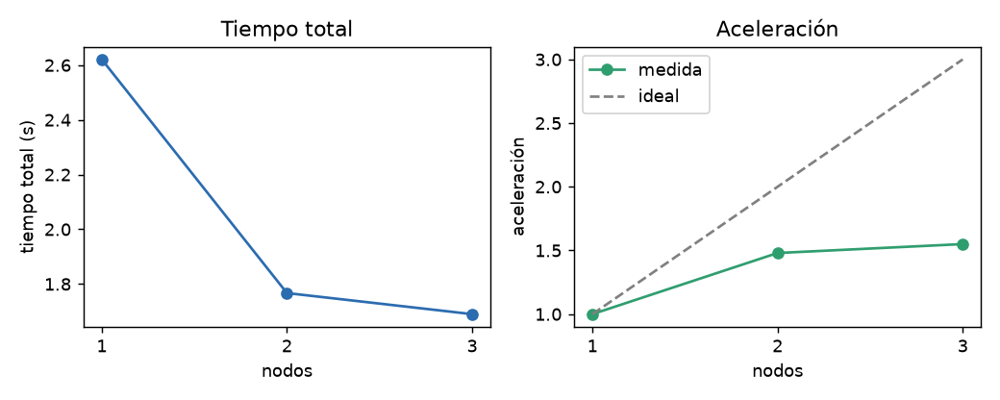
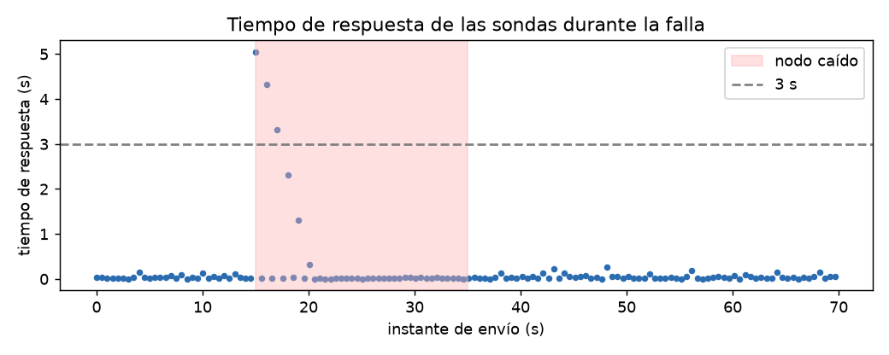

# Informe experimental — ComplexNet API (Fase 3)

Este informe se genera automáticamente con `experiments/report.py` a partir de los resultados de `experiments/run_experiments.py`. Los datos crudos (CSV) están en `experiments/results/20261126-104206/`.

## 1. Entorno

| Dato | Valor |
|---|---|
| Fecha | 2026-11-26 10:42:06 |
| Entorno | 3 computadores en red local |
| Nodos | nodo-01 (172.25.4.83), nodo-03 (172.25.5.66), nodo-02 (172.25.7.119) |
| Equipo que ejecutó los experimentos | MSI (Windows-11-10.0.26200-SP0) |
| CPU / RAM de ese equipo | 12 hilos / 15.7 GB |
| Python | 3.13.7 |
| Estrategia por defecto | weighted_load |
| Tamaño de tarea (puntos Monte Carlo) | 12,000,000 |
| Modo | completo |

**Metodología.** Cada nodo es un proceso independiente que se comunica por UDP/JSON. Las cargas de trabajo son tareas CPU-bound de Monte Carlo (estimación de π) que se reparten con el planificador distribuido. Cada medición se repite varias veces y se reporta la media y la desviación estándar. Las fallas se inyectan con el endpoint `/admin/fail` del nodo víctima, que deja de enviar y recibir mensajes durante unos segundos (equivale a una caída o desconexión de la red).

## 2. Latencia de comunicación

| Nodo | Ping medio (ms) | Ping mín (ms) | Ping máx (ms) | Tarea mínima p50 (ms) | Tarea mínima p95 (ms) |
|---|---|---|---|---|---|
| nodo-02 | 61.116 | 30.221 | 136.877 | 7.733 | 26.384 |
| nodo-03 | 24.971 | 16.617 | 38.265 | 9.414 | 21.802 |

*Ping* es el RTT de los mensajes `PING/PONG` que cada nodo mide a sus vecinos. *Tarea mínima* es el tiempo completo de una tarea `echo` (asignación, envío, ejecución y respuesta).

## 3. Tiempo de descubrimiento

Se arranca un nodo nuevo (sin conocer a nadie) y se mide el tiempo hasta que descubre a todos los demás nodos.

| Intento | Segundos | Vecinos encontrados | Completo |
|---|---|---|---|
| 1 | 30.034 | 2 | no |
| 2 | 30.038 | 2 | no |
| 3 | 30.043 | 2 | no |
| 4 | 0.203 | 3 | sí |
| 5 | 0.102 | 3 | sí |
| 6 | 0.101 | 3 | sí |
| 7 | 0.102 | 3 | sí |
| 8 | 0.101 | 3 | sí |

Descubrimiento completo en 5/8 intentos. En los 5 intentos completos tardó **0.12 s** de media (mín 0.10 s, máx 0.20 s). En los 3 restantes se agotó el límite de 30 s sin encontrar a todos los vecinos: el *broadcast* UDP no tiene garantía de entrega y en una red Wi-Fi puede perderse; por eso el sistema también admite vecinos semilla por IP (`--peers`).

## 4. Escalabilidad

### 4.1 Más nodos, misma carga

Se ejecuta el mismo lote de 24 tareas restringiendo el número de nodos disponibles.

| Nodos | Tiempo total (s) | ± σ | Tareas/s | Aceleración |
|---|---|---|---|---|
| 1 | 2.621 | 0.26 | 9.26 | 1.0× |
| 2 | 1.767 | 0.374 | 14.33 | 1.48× |
| 3 | 1.69 | 0.137 | 14.29 | 1.55× |

Con 3 nodos la aceleración fue **1.55×** (ideal: 3×). La diferencia con el ideal se debe a la sobrecarga de coordinación (mensajes, ACK), a que las tareas se reparten en bloques discretos y a las diferencias de capacidad entre equipos.

### 4.2 Incremento progresivo de la carga

| Tareas | Tiempo total (s) | Tareas/s | Latencia media (s) | p95 (s) | Tráfico enviado (KB/s) | CPU usada media (%) |
|---|---|---|---|---|---|---|
| 4 | 0.222 | 17.99 | 0.197 | 0.221 | 6.79 | nodo-01: 24.5, nodo-03: 77.0, nodo-02: 20.2 |
| 8 | 0.454 | 17.61 | 0.286 | 0.453 | 3.92 | nodo-01: 15.7, nodo-03: 77.0, nodo-02: 17.4 |
| 16 | 1.291 | 12.4 | 0.487 | 0.898 | 2.71 | nodo-01: 21.1, nodo-03: 41.8, nodo-02: 17.4 |
| 32 | 2.328 | 13.75 | 1.142 | 2.233 | 4.87 | nodo-01: 14.0, nodo-03: 52.6, nodo-02: 22.4 |
| 64 | 4.417 | 14.49 | 1.455 | 3.801 | 3.57 | nodo-01: 17.3, nodo-03: 28.1, nodo-02: 23.4 |

Al multiplicar la carga por 16 (de 4 a 64 tareas) el tiempo total se multiplicó por 19.9 y el rendimiento pasó de 17.99 a 14.49 tareas/s. El tráfico de control fue de 3.57 KB/s con la mayor carga.

## 5. Comparación de estrategias de asignación

Mismo lote de 36 tareas de tamaño heterogéneo (½×, 1× y 2×) con cada estrategia. *Desbalance* es el coeficiente de variación del número de tareas por nodo (0 = reparto perfecto).

| Estrategia | Tiempo total (s) | ± σ | Latencia media (s) | p95 (s) | Desbalance | Tareas por nodo |
|---|---|---|---|---|---|---|
| F(i,j) del diseño | 5.029 | 2.334 | 2.621 | 4.929 | 1.414 | nodo-01: 0.0, nodo-02: 24.0, nodo-03: 12.0 |
| F(i,j) + carga | 3.02 | 0.79 | 1.328 | 2.733 | 0.972 | nodo-01: 9.7, nodo-02: 20.7, nodo-03: 5.7 |
| Menos cargado | 2.948 | 0.408 | 0.944 | 2.603 | 0.0 | nodo-01: 12.0, nodo-02: 12.0, nodo-03: 12.0 |
| Menor latencia | 3.365 | 0.087 | 1.701 | 3.275 | 1.414 | nodo-01: 36.0, nodo-02: 0.0, nodo-03: 0.0 |
| Round-robin | 2.983 | 0.126 | 0.99 | 2.812 | 0.0 | nodo-01: 12.0, nodo-02: 12.0, nodo-03: 12.0 |
| Aleatoria | 3.078 | 0.34 | 1.011 | 2.855 | 0.203 | nodo-01: 9.7, nodo-02: 12.3, nodo-03: 14.0 |

La estrategia con menor tiempo total fue **Menos cargado** (2.948 s) y la de mayor tiempo **F(i,j) del diseño** (5.029 s).
La función F(i,j) del diseño original tardó 5.029 s con un desbalance de 1.414. Esa función no considera la carga actual, y la normalización min-max convierte diferencias mínimas de CPU y memoria entre nodos desocupados en diferencias de 0 a 1, por lo que puede concentrar tareas en pocos nodos.
La variante `weighted_load` (término de carga y normalización robusta) redujo el tiempo total en 40 % y el desbalance de 1.414 a 0.972, conservando el criterio multicriterio.

## 6. Tolerancia a fallos

Un nodo cae 2 s después de empezar un lote de tareas (deja de enviar y recibir durante 25 s).

| Intento | Nodo caído | Tareas | Completadas | % completado | Reasignadas | Detección (s) | Recuperación (s) | Tiempo total (s) |
|---|---|---|---|---|---|---|---|---|
| 1 | nodo-02 | 20 | 20 | 100.0 | 10 | 4.25 | 4.16 | 10.41 |
| 2 | nodo-03 | 20 | 20 | 100.0 | 4 | 5.38 | 1.22 | 8.61 |
| 3 | nodo-02 | 20 | 20 | 100.0 | 15 | 4.31 | 6.06 | 12.38 |
| 4 | nodo-03 | 20 | 20 | 100.0 | 4 | 4.98 | 1.18 | 8.17 |

- Detección de la caída: media **4.73 s** (requisito: ≤ 5 s de silencio; la detección corre cada 0.5 s).
- Tareas completadas pese a la caída: **100 %** (sin intervención manual).
- La *recuperación* es el tiempo desde la primera reasignación hasta que la tarea reasignada termina (incluye volver a ejecutarla).

## 7. Disponibilidad del servicio

Cada 0.5 s se envía una tarea de sondeo mientras nodo-02 falla entre t = 15 s y t = 35 s.

| Métrica | Valor |
|---|---|
| Sondas enviadas | 140 |
| Completadas | 100.0 % |
| Completadas en ≤ 3 s | 97.86 % |

Las sondas enviadas al nodo caído no reciben `TASK_ACK`; tras el timeout se reasignan a otro nodo y se completan, por eso la disponibilidad es alta pero algunas respuestas tardan alrededor del timeout de 5 s.

## 8. Consumo de recursos del nodo coordinador

| Métrica | Valor |
|---|---|
| Mensajes enviados / recibidos | 2124 / 3469 |
| Tráfico enviado / recibido | 546 KB / 838 KB |
| Duración | 468 s |
| Tráfico medio enviado | 1.17 KB/s |
| Tareas enviadas / completadas / reasignadas / fallidas | 1308 / 1308 / 39 / 0 |

El uso de CPU por nodo durante cada carga se reporta en las secciones 4.2 y 5.

## 9. Conclusiones y limitaciones

- El sistema se **autoorganiza**: los nodos se descubren solos, reparten el trabajo con reglas locales y se recuperan de caídas sin coordinador central.
- La **escalabilidad** depende de que las tareas sean lo bastante grandes como para amortizar la comunicación; con tareas muy pequeñas la coordinación domina.
- **Estrategias:** en esta corrida la de menor tiempo total fue Menos cargado (2.948 s); el reparto equitativo importa porque cada nodo ejecuta pocas tareas a la vez y el resto espera en cola.
- La **tolerancia a fallos** se apoya en detección por silencio (≤ 5 s) y reasignación; una tarea no se pierde mientras exista al menos un nodo activo.
- **Limitaciones:** el ancho de banda de cada nodo es un valor declarado, no medido; UDP no garantiza entrega (se compensa con ACK, timeout y reasignación); el coordinador (nodo que envía la tarea) es un punto único para *sus* tareas: si cae, pierde su estado; no hay persistencia.
