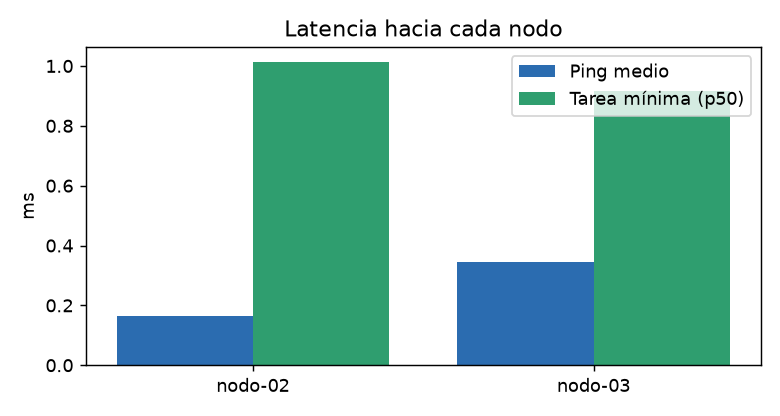
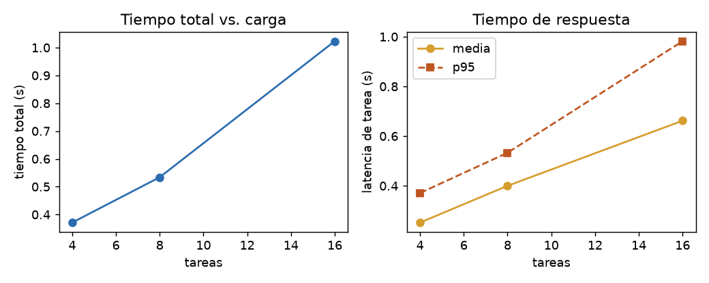
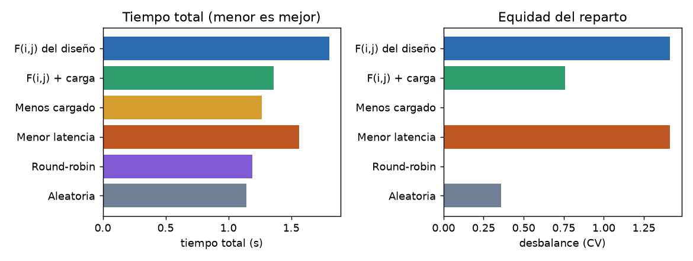
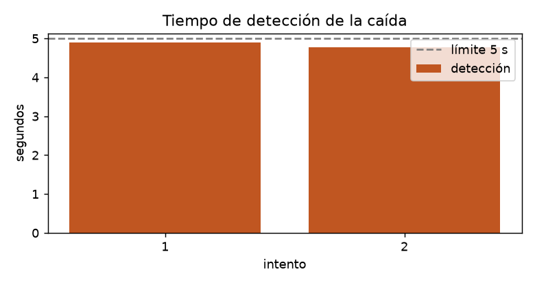

# Informe experimental — ComplexNet API (Fase 3)

Este informe se genera automáticamente con `experiments/report.py` a partir de los resultados de `experiments/run_experiments.py`. Los datos crudos (CSV) están en `experiments/results/20261125-142252/`.

## 1. Entorno

| Dato | Valor |
|---|---|
| Fecha | 2026-11-25 14:22:52 |
| Entorno | 1 PC (3 procesos en localhost), prueba rapida |
| Nodos | nodo-01 (127.0.0.1), nodo-03 (127.0.0.1), nodo-02 (127.0.0.1) |
| Equipo que ejecutó los experimentos | MSI (Windows-11-10.0.26200-SP0) |
| CPU / RAM de ese equipo | 12 hilos / 15.7 GB |
| Python | 3.13.7 |
| Estrategia por defecto | weighted_load |
| Tamaño de tarea (puntos Monte Carlo) | 12,000,000 |
| Modo | rápido (reducido) |

**Metodología.** Cada nodo es un proceso independiente que se comunica por UDP/JSON. Las cargas de trabajo son tareas CPU-bound de Monte Carlo (estimación de π) que se reparten con el planificador distribuido. Cada medición se repite varias veces y se reporta la media y la desviación estándar. Las fallas se inyectan con el endpoint `/admin/fail` del nodo víctima, que deja de enviar y recibir mensajes durante unos segundos (equivale a una caída o desconexión de la red).

## 2. Latencia de comunicación

| Nodo | Ping medio (ms) | Ping mín (ms) | Ping máx (ms) | Tarea mínima p50 (ms) | Tarea mínima p95 (ms) |
|---|---|---|---|---|---|
| nodo-02 | 0.164 | 0.141 | 0.194 | 1.012 | 1.792 |
| nodo-03 | 0.344 | 0.32 | 0.376 | 0.915 | 1.415 |

*Ping* es el RTT de los mensajes `PING/PONG` que cada nodo mide a sus vecinos. *Tarea mínima* es el tiempo completo de una tarea `echo` (asignación, envío, ejecución y respuesta).

## 3. Tiempo de descubrimiento

Se arranca un nodo nuevo (sin conocer a nadie) y se mide el tiempo hasta que descubre a todos los demás nodos.

| Intento | Segundos | Vecinos encontrados | Completo |
|---|---|---|---|
| 1 | 0.101 | 3 | sí |
| 2 | 0.101 | 3 | sí |
| 3 | 0.102 | 3 | sí |

Media: **0.10 s** (mín 0.10 s, máx 0.10 s); descubrimiento completo en 3/3 intentos. El intervalo de los beacons es de 2 s, que acota el peor caso.

## 4. Escalabilidad

### 4.1 Más nodos, misma carga

Se ejecuta el mismo lote de 12 tareas restringiendo el número de nodos disponibles.

| Nodos | Tiempo total (s) | ± σ | Tareas/s | Aceleración |
|---|---|---|---|---|
| 1 | 1.373 | 0.0 | 8.74 | 1.0× |
| 2 | 0.821 | 0.0 | 14.62 | 1.67× |
| 3 | 0.879 | 0.0 | 13.66 | 1.56× |

Con 3 nodos la aceleración fue **1.56×** (ideal: 3×). La diferencia con el ideal se debe a la sobrecarga de coordinación (mensajes, ACK), a que las tareas se reparten en bloques discretos y a las diferencias de capacidad entre equipos.

### 4.2 Incremento progresivo de la carga

| Tareas | Tiempo total (s) | Tareas/s | Latencia media (s) | p95 (s) | Tráfico enviado (KB/s) | CPU usada media (%) |
|---|---|---|---|---|---|---|
| 4 | 0.371 | 10.77 | 0.252 | 0.371 | 2.55 | nodo-01: 54.2, nodo-03: 17.9, nodo-02: 33.9 |
| 8 | 0.534 | 14.99 | 0.4 | 0.533 | 3.07 | nodo-01: 45.8, nodo-03: 35.6, nodo-02: 35.9 |
| 16 | 1.023 | 15.63 | 0.662 | 0.982 | 4.03 | nodo-01: 44.8, nodo-03: 53.3, nodo-02: 37.9 |

Al multiplicar la carga por 4 (de 4 a 16 tareas) el tiempo total se multiplicó por 2.8 y el rendimiento pasó de 10.77 a 15.63 tareas/s. El tráfico de control fue de 4.03 KB/s con la mayor carga.

## 5. Comparación de estrategias de asignación

Mismo lote de 18 tareas de tamaño heterogéneo (½×, 1× y 2×) con cada estrategia. *Desbalance* es el coeficiente de variación del número de tareas por nodo (0 = reparto perfecto).

| Estrategia | Tiempo total (s) | ± σ | Latencia media (s) | p95 (s) | Desbalance | Tareas por nodo |
|---|---|---|---|---|---|---|
| F(i,j) del diseño | 1.804 | 0.0 | 1.01 | 1.797 | 1.414 | nodo-01: 0.0, nodo-02: 18.0, nodo-03: 0.0 |
| F(i,j) + carga | 1.361 | 0.0 | 0.654 | 1.206 | 0.758 | nodo-01: 11.0, nodo-02: 0.0, nodo-03: 7.0 |
| Menos cargado | 1.267 | 0.0 | 0.663 | 1.141 | 0.0 | nodo-01: 6.0, nodo-02: 6.0, nodo-03: 6.0 |
| Menor latencia | 1.563 | 0.0 | 0.876 | 1.492 | 1.414 | nodo-01: 18.0, nodo-02: 0.0, nodo-03: 0.0 |
| Round-robin | 1.192 | 0.0 | 0.667 | 1.11 | 0.0 | nodo-01: 6.0, nodo-02: 6.0, nodo-03: 6.0 |
| Aleatoria | 1.145 | 0.0 | 0.639 | 1.021 | 0.36 | nodo-01: 9.0, nodo-02: 4.0, nodo-03: 5.0 |

La estrategia con menor tiempo total fue **Aleatoria** (1.145 s) y la de mayor tiempo **F(i,j) del diseño** (1.804 s).
La función F(i,j) del diseño original tardó 1.804 s con un desbalance de 1.414. Esa función no considera la carga actual, y la normalización min-max convierte diferencias mínimas de CPU y memoria entre nodos desocupados en diferencias de 0 a 1, por lo que puede concentrar tareas en pocos nodos.
La variante `weighted_load` (término de carga y normalización robusta) redujo el tiempo total en 25 % y el desbalance de 1.414 a 0.758, conservando el criterio multicriterio.

*Nota: σ = 0 porque en el modo rápido cada medición se hizo una sola vez.*

## 6. Tolerancia a fallos

Un nodo cae 2 s después de empezar un lote de tareas (deja de enviar y recibir durante 25 s).

| Intento | Nodo caído | Tareas | Completadas | % completado | Reasignadas | Detección (s) | Recuperación (s) | Tiempo total (s) |
|---|---|---|---|---|---|---|---|---|
| 1 | nodo-02 | 12 | 12 | 100.0 | 2 | 4.89 | 1.26 | 8.14 |
| 2 | nodo-03 | 12 | 12 | 100.0 | 2 | 4.77 | 1.18 | 7.95 |

- Detección de la caída: media **4.83 s** (requisito: ≤ 5 s de silencio; la detección corre cada 0.5 s).
- Tareas completadas pese a la caída: **100 %** (sin intervención manual).
- La *recuperación* es el tiempo desde la primera reasignación hasta que la tarea reasignada termina (incluye volver a ejecutarla).

## 7. Disponibilidad del servicio

Cada 0.5 s se envía una tarea de sondeo mientras nodo-02 falla entre t = 8 s y t = 18 s.

| Métrica | Valor |
|---|---|
| Sondas enviadas | 60 |
| Completadas | 100.0 % |
| Completadas en ≤ 3 s | 96.67 % |

Las sondas enviadas al nodo caído no reciben `TASK_ACK`; tras el timeout se reasignan a otro nodo y se completan, por eso la disponibilidad es alta pero algunas respuestas tardan alrededor del timeout de 5 s.

## 8. Consumo de recursos del nodo coordinador

| Métrica | Valor |
|---|---|
| Mensajes enviados / recibidos | 598 / 748 |
| Tráfico enviado / recibido | 153 KB / 174 KB |
| Duración | 143 s |
| Tráfico medio enviado | 1.07 KB/s |
| Tareas enviadas / completadas / reasignadas / fallidas | 286 / 286 / 4 / 0 |

El uso de CPU por nodo durante cada carga se reporta en las secciones 4.2 y 5.

## 9. Conclusiones y limitaciones

- El sistema se **autoorganiza**: los nodos se descubren solos, reparten el trabajo con reglas locales y se recuperan de caídas sin coordinador central.
- La **escalabilidad** depende de que las tareas sean lo bastante grandes como para amortizar la comunicación; con tareas muy pequeñas la coordinación domina.
- **Estrategias:** en esta corrida la de menor tiempo total fue Aleatoria (1.145 s); el reparto equitativo importa porque cada nodo ejecuta pocas tareas a la vez y el resto espera en cola.
- La **tolerancia a fallos** se apoya en detección por silencio (≤ 5 s) y reasignación; una tarea no se pierde mientras exista al menos un nodo activo.
- **Limitaciones:** el ancho de banda de cada nodo es un valor declarado, no medido; UDP no garantiza entrega (se compensa con ACK, timeout y reasignación); el coordinador (nodo que envía la tarea) es un punto único para *sus* tareas: si cae, pierde su estado; no hay persistencia.
- **Importante:** estos resultados se obtuvieron en un solo computador (procesos independientes), por lo que los nodos compiten por la misma CPU y la latencia de red es de *loopback*. Deben repetirse en los 3 computadores para el informe final.
